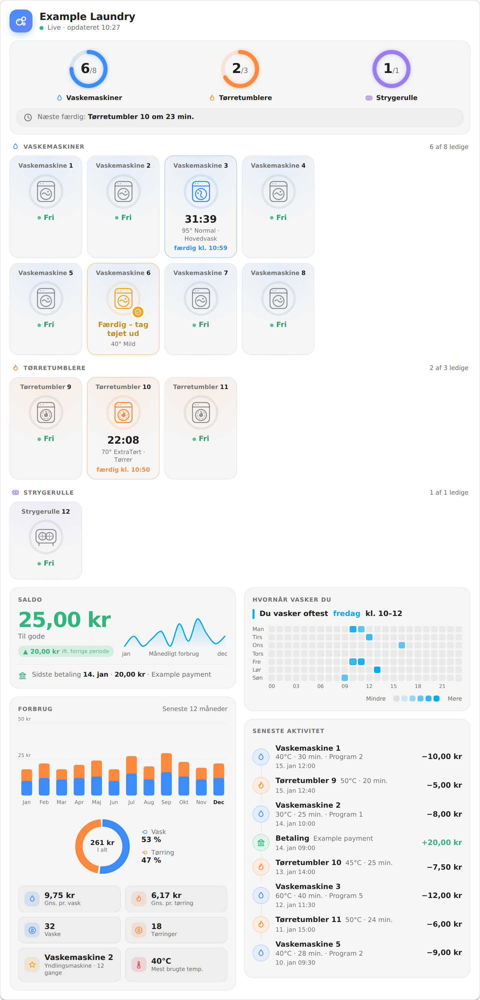
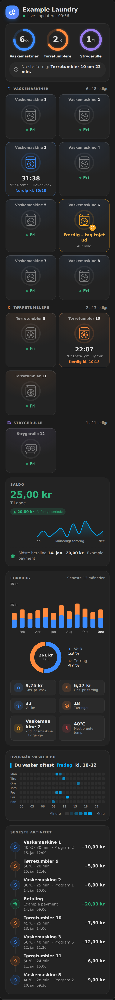
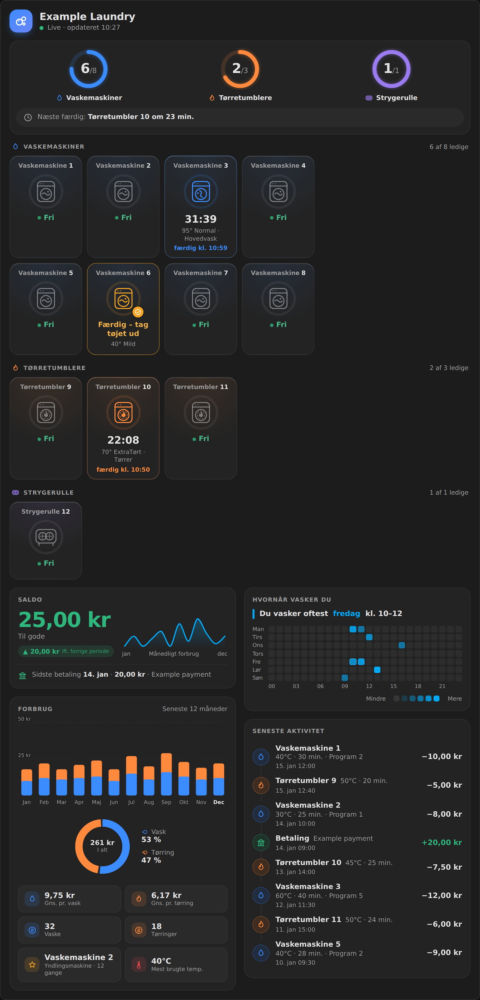
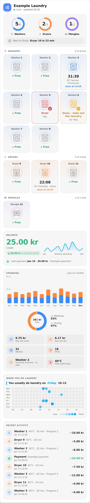
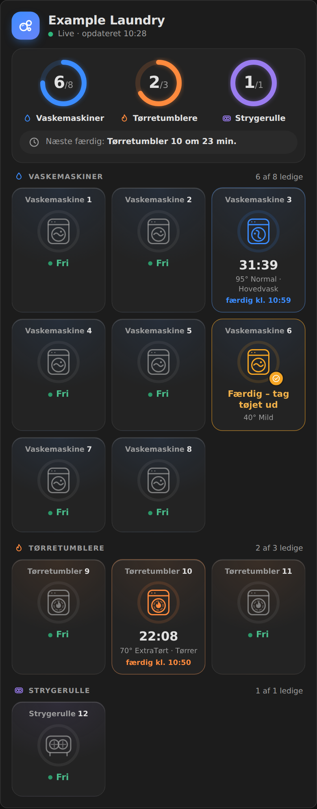

# E-Vaskeri for Home Assistant

Custom integration (`e_vaskeri`) that shows the machines of an E-Vaskeri laundry room and a
resident's laundry account in Home Assistant. It talks to the separate
[E-Vaskeri API](https://github.com/fclante/e-vaskeri-api) – not to e-vaskeri.dk directly.

- Live status for every washer, dryer and mangle, with program, step and finish time
- Free-machine counters and the time the next machine becomes free
- Balance, previous period, spend this month and last payment
- `e_vaskeri_cycle_finished` event for notifications (+ ready-made blueprint)
- Optional Lovelace dashboard card, served and registered automatically

Requires Home Assistant **2026.8** or newer. Polling is `local_polling`: the integration only
talks to your own API instance.

## Prerequisite: the E-Vaskeri API

This repository contains the Home Assistant integration and Lovelace card, not the API service.
You must first deploy the [E-Vaskeri API](https://github.com/fclante/e-vaskeri-api) and configure
it with your own E-Vaskeri credentials. The API repository documents configuration and deployment.
The API base URL must be reachable from Home Assistant; do not expose the service to the public
internet unless you have secured it appropriately.

## Installation

### Home Assistant 2026.11 and newer: Marketplace

1. Open **Settings → Marketplace**.
2. Select **Add from link** and enter `https://github.com/fclante/e-vaskeri-ha-app`.
3. If prompted, select **Integration**, then add the repository.
4. Open the E-Vaskeri repository in Marketplace and select **Install**.
5. If Home Assistant requests a restart, restart it.

Marketplace is built into Home Assistant 2026.11 and newer; you do not need to install HACS separately.

### Home Assistant 2026.10 and older: HACS custom repository

Install HACS first by following the [official HACS download instructions](https://hacs.xyz/docs/use/download/download/).
Then, in HACS, open **Integrations → ⋮ → Custom repositories**, add
`https://github.com/fclante/e-vaskeri-ha-app` as an **Integration**, download E-Vaskeri, and restart
Home Assistant.

For details about Marketplace and the transition from HACS, see the [official Marketplace documentation](https://hacs.xyz/docs/marketplace/).

### Manual installation

Copy the `custom_components/e_vaskeri` directory into
`<Home Assistant config>/custom_components/e_vaskeri`, then restart Home Assistant:

```bash
cp -r custom_components/e_vaskeri /config/custom_components/e_vaskeri
```

The notification blueprint is available at
[`blueprints/automation/e_vaskeri/notify_cycle_finished.yaml`](blueprints/automation/e_vaskeri/notify_cycle_finished.yaml).

## Setup

*Settings → Devices & services → Add integration → E-Vaskeri*

| Field | Description |
| --- | --- |
| API base URL | For example `http://e-vaskeri-api.default.svc:5000`. Validated against `/health` and `/api/v1/machines`. |

No API key is required or sent. Keys saved by older integration versions are ignored and
left unchanged.

The same API URL can only be added once. Use **Reconfigure** to change the URL.

**Options** (*Configure* on the integration):

| Option | Default | Minimum |
| --- | --- | --- |
| Machines poll interval | 30 s | 10 s |
| Account poll interval (balance, statement, stats, periods, prices, messages, calendar) | 600 s | 60 s |
| Opening-hours schedule | None (24/7 polling) | — |

The API itself refreshes machines about every 20 s and account data about every 10 minutes, so
polling faster brings no benefit.

### Opening hours

To pause requests when your laundry is closed:

1. In **Settings → Devices & services → Helpers**, create a **Schedule** helper.
2. Set its active periods to the laundry's opening hours. Different weekdays and multiple
   periods per day are supported. For overnight hours, split the period across adjacent days.
   The helper uses Home Assistant's configured time zone and handles daylight-saving changes.
3. In the E-Vaskeri integration's **Configure** dialog, select this helper under
   **Opening-hours schedule**. Each integration entry can use its own helper.

Leave the selection empty, or clear it later, for continuous 24/7 polling.
While the schedule is off, both machine and account polling pause, including manual entity
refreshes. Last known data remains visible but becomes stale; the card may show its existing
stale-data warning. Requests already in flight are allowed to finish.

Setup and reload still perform an initial refresh of both data groups, even while closed,
and failed setup retains Home Assistant's normal retry behavior. Opening immediately refreshes
both groups and resumes their configured intervals, unless automatic polling is disabled in
Home Assistant. Cycle-finished notifications are not inferred across a closed period: detection
resumes after the first successful machine refresh.

If a selected helper is missing, unknown or unavailable, polling pauses and a warning is logged.
Restore the helper to resume polling during its active periods, or clear the selection for 24/7
operation.

**This only controls requests from Home Assistant to your API instance.** The separate
E-Vaskeri API service may continue polling e-vaskeri.dk independently; this option does not
change that service's upstream polling.

## Devices and entities

A **hub device** named after the laundry location (fallback `E-Vaskeri`) holds the summary and
account entities. Every machine is a **child device** (Washer / Dryer / Mangle). Machines that
appear later are added automatically. Entity IDs below are examples for a hub called
"Example Laundry" and a machine called "Vaskemaskine 3".

### Per machine

| Entity | Name | Translation key | Notes |
| --- | --- | --- | --- |
| `sensor.vaskemaskine_3_status` | Status | `machine_state` | Enum `free`, `busy`, `done`, `error`, `unknown`. Attributes: `program`, `step`, `raw_status`, `remaining_seconds`, `ends_at`, `machine_id`, `machine_type`. |
| `sensor.vaskemaskine_3_finishes` | Finishes | `machine_finishes` | Timestamp; unknown unless the machine is busy. |
| `binary_sensor.vaskemaskine_3_in_use` | In use | `machine_in_use` | Occupancy; on for `busy` and `done`, off for `free`. |

### Hub – summary

| Entity | Name | Translation key | Notes |
| --- | --- | --- | --- |
| `sensor.example_laundry_free_washers` | Free washers | `free_washers` | |
| `sensor.example_laundry_free_dryers` | Free dryers | `free_dryers` | |
| `sensor.example_laundry_free_machines` | Free machines | `free_machines` | |
| `sensor.example_laundry_next_free` | Next free | `next_free` | Timestamp; attributes `name`, `id`. |
| `event.example_laundry_cycle_finished` | Cycle finished | `cycle_finished` | Event type `cycle_finished`. |

### Hub – account

| Entity | Name | Translation key | Notes |
| --- | --- | --- | --- |
| `sensor.example_laundry_balance` | Balance | `balance` | DKK, negative when money is owed. |
| `sensor.example_laundry_previous_period` | Previous period | `previous_period_balance` | |
| `sensor.example_laundry_spend_this_month` | Spend this month | `current_month_spend` | |
| `sensor.example_laundry_last_payment` | Last payment | `last_payment` | Attributes `date`, `description`. |

### Hub – bookings and messages

Created only when the API provides them: an older API version, or a location without reservations, simply doesn't get these sensors. They refresh with the account interval.

| Entity | Name | Translation key | Notes |
| --- | --- | --- | --- |
| `sensor.example_laundry_next_bookable_slot` | Next bookable slot | `next_bookable_slot` | Timestamp (the API reports local time, read in the Home Assistant time zone). Attributes `end`, `free_unit_ids`, `calendar_id`. |
| `sensor.example_laundry_bookings_remaining` | Bookings remaining | `bookings_remaining` | Unknown when there is no limit. |
| `sensor.example_laundry_messages` | Messages | `messages` | Number of messages. Attributes `latest` (newest message that is not a masked system e-mail) and `messages` (up to 5). One-time codes and e-mail addresses are masked by the API. |

### Hub – overview sensors (power the dashboard card)

These carry whole API payloads as attributes and are excluded from the recorder.

| Entity | Translation key | State | Attributes |
| --- | --- | --- | --- |
| `sensor.example_laundry_machines_overview` | `machines_overview` | Number of free machines | `location`, `updated_at`, `upstream_updated`, `summary`, `machines` (API machines, each with an extra `entity_id` pointing at its Status sensor) |
| `sensor.example_laundry_account_overview` | `account_overview` | Balance (DKK) | `currency`, `balance_dkk`, `owed_dkk`, `previous_period_dkk`, `last_payment`, `stats`, `recent` (last 15 statement entries), `periods` (last 12 billing periods), `prices` (price per machine group), `updated_at` |

## Cycle finished event

Whenever a machine goes from `busy` to `free` or `done` (never on startup) the integration

1. fires the bus event **`e_vaskeri_cycle_finished`**, and
2. triggers the **Cycle finished** event entity, so the UI automation editor can use it as trigger.

Event data:

| Key | Description |
| --- | --- |
| `machine_id` | API machine id |
| `name` | Machine name, e.g. `Vaskemaskine 3` |
| `type` | `washer`, `dryer`, `mangle` or `other` |
| `program` | Program that was running (may be `null`) |
| `device_id` | Home Assistant device id of the machine |
| `entry_id` | Config entry id |
| `mine` | `true` when your own account paid for the cycle, `false` when someone else's did, `null` when the statement could not be read |

`mine` compares the finished machine against your statement: the cycle is yours when the
statement has a usage of that machine that started after the machine was last seen free. If the
cached statement has no match, the integration fetches it once more before deciding. A machine
that was already running when Home Assistant started is matched against usages from up to four
hours before startup.

Example automation:

```yaml
automation:
  - alias: "Laundry finished"
    triggers:
      - trigger: event
        event_type: e_vaskeri_cycle_finished
    conditions:
      - condition: template
        value_template: "{{ trigger.event.data.type == 'washer' and trigger.event.data.mine }}"
    actions:
      - action: notify.mobile_app_my_phone
        data:
          title: "E-Vaskeri"
          message: "{{ trigger.event.data.name }} is finished ({{ trigger.event.data.program }})"
```

The blueprint `blueprints/automation/e_vaskeri/notify_cycle_finished.yaml` does the same with
inputs for machine type and device filters, only-my-cycles, notify action, title and message template.

## Dashboard card

The integration ships a Lovelace card, **`custom:e-vaskeri-card`**, and registers it automatically
(`add_extra_js_url`, served from `/e_vaskeri/e-vaskeri-card.js`) – no manual resource is needed.
It follows your Home Assistant theme (light/dark), language (Danish and English) and number/time format.

| Wide, light | Narrow, dark |
| --- | --- |
|  |  |
|  |  |

Compact variant (`compact: true`): 

What it shows, top to bottom:

1. **Header** – location, live indicator and the upstream update time (grey/red when unavailable, amber
   "data is N min old" when the last poll is more than 2 minutes old).
2. **Availability rings** – free/total per machine type plus a "next free in …" chip (when every machine of
   a type is busy; otherwise a subtle "next to finish" chip).
3. **Machine tiles** – grouped by type. Busy machines spin and show a live mm:ss countdown (ticking
   client-side), program/step and finish clock time; *done* tiles pulse amber, *error* tiles turn red.
   Tap a tile to open the machine's more-info dialog.
4. **Balance** – balance, change vs. previous period, last payment and a monthly-spend sparkline.
5. **Spending** – 12-month stacked bar chart (washing/drying, tooltip on hover/tap), washer/dryer share
   donut and KPI chips (average per wash/dry, counts, favourite machine, most used temperature).
6. **Heatmap** – weekday × hour usage and a computed insight ("You usually do laundry on Friday 11–13").
7. **Recent activity** – the latest statement entries as a timeline.

### Configuration

All options are optional; `type: custom:e-vaskeri-card` alone works. There is also a visual editor.

| Option | Type | Default | Description |
| --- | --- | --- | --- |
| `title` | string | location name | Header title. |
| `show` | list | all | Sections to show: `machines`, `balance`, `spend`, `heatmap`, `activity`. The header is always shown. |
| `compact` | bool | `false` | Only header, availability rings and machine tiles (overrides `show`). |
| `machine_types` | list | all | Restrict rings/tiles to `washer`, `dryer` and/or `mangle`. |
| `language` | `da` \| `en` | HA language | Force the card language and date/number formatting. Anything but Danish falls back to English. |
| `machines_entity` | entity id | auto | Override the machines overview sensor (normally auto-discovered). |
| `account_entity` | entity id | auto | Override the account overview sensor (normally auto-discovered). |

```yaml
type: custom:e-vaskeri-card
title: Vaskeriet
show: [machines, balance, activity]
machine_types: [washer, dryer]
language: da
```

A ready-made dashboard (sections view with the full card, plus a masonry view with a compact card) is in
[`dashboards/e-vaskeri.yaml`](dashboards/e-vaskeri.yaml) – paste it into the dashboard's raw configuration editor.

### Entities the card reads

The card never needs entity ids: it looks in the entity registry (`hass.entities`) for entities with
`platform: e_vaskeri` and `translation_key` `machines_overview` / `account_overview`.

- **`machines_overview`** – state: number of free machines. Attributes: `location`, `updated_at`,
  `upstream_updated`, `summary` (`total`, `free`, `busy`, `by_type`, `next_free`) and `machines` (list of
  `id`, `name`, `type`, `state`, `raw_status`, `program`, `step`, `remaining_seconds`, `ends_at`,
  `entity_id`). `entity_id` (the machine's Status sensor) is what a tile opens in more-info.
- **`account_overview`** – state: balance in DKK (negative = owed). Attributes: `currency`, `balance_dkk`,
  `owed_dkk`, `previous_period_dkk`, `last_payment`, `updated_at`, `stats` (`months`, `totals`,
  `current_month_spend_dkk`, `avg_cost_per_wash_dkk`, `avg_cost_per_dry_dkk`, `favourite_machine`,
  `top_programs`, `top_temperatures`, `heatmap` 7 × 24 with Monday first) and `recent` (statement entries).

### Building and developing the card

The source lives in [`card/`](card/) (Lit 3 + TypeScript + Vite). The built bundle
`custom_components/e_vaskeri/www/e-vaskeri-card.js` is committed, so you only need Node when changing the card.

```bash
cd card
npm install
npm run build        # writes ../custom_components/e_vaskeri/www/e-vaskeri-card.js
npm run dev          # dev harness at /dev/index.html: mock hass, light/dark, state switcher,
                     # time travel (+1/+5/+20 min), width slider; add ?bundle=1 to test the built file
npm run typecheck
npm test             # vitest + jsdom: countdown/progress, heatmap insight, formatting, discovery,
                     # stale detection, render smoke tests
npm run screenshots  # needs `npx playwright install chromium`; writes docs/screenshots/*.png
```

Pure logic is in `card/src/logic/*.ts`, components in `card/src/components/*.ts`.

### Card limitations

- The total cycle length is unknown, so the progress ring is derived from the largest remaining time the
  card has seen for a machine; a machine that is already half done when the page loads starts the ring at
  0 % (it shows an indeterminate ring for the first seconds). Countdown and finish time are always exact.
- The stale warning uses a fixed 2-minute threshold, so a poll interval longer than that shows "data is N min old".
- Long-press / notify actions on tiles are not implemented; tapping opens more-info only.
- The visual editor relies on Home Assistant's `ha-form` and can only be previewed inside Home Assistant.
- Everything is bundled inline; the card makes no network requests and uses no external fonts or images.

## Troubleshooting

- **Cannot connect** – the URL must be reachable *from Home Assistant* (not from your browser).
  Check `curl <url>/health`.
- **API access denied (401/403)** – check the API service and any reverse proxy. The API does
  not require a key. After restoring access, submit the key-free retry prompt to reload.
- **Entities unavailable** – the API or the upstream laundry site is failing; see the Home
  Assistant log for `e_vaskeri` and the API's `/ready` endpoint. Entities recover on the next poll.
- **No dashboard card** – the integration logs a warning if
  `custom_components/e_vaskeri/www/e-vaskeri-card.js` is missing (the card is not built/copied).
- **Download diagnostics** from the integration page; the URL and any legacy saved API key
  are redacted.

## Development

Tests use `pytest-homeassistant-custom-component`, which needs Python 3.14; `uv` provides it:

```bash
uv sync
uv run pytest
uv run ruff check . && uv run ruff format --check .
```
